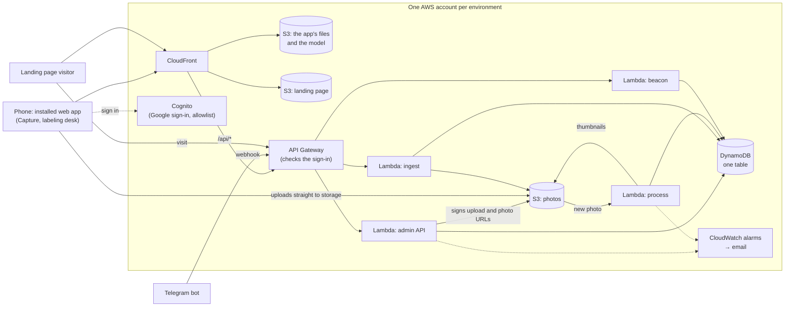
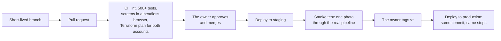

# BGU Cats

Identifying, naming and tracking the cats of the Ben-Gurion University
campus: about fifty of them, on an architecture that is deliberately not
limited to one campus. People photograph a cat; admins say which cat it
is; a recognition model, running in the phone's browser, learns to guess.

It is also a deliberately over-built platform for its size: one person and
Claude, run like a small product team, with separate cloud accounts per
environment, a pipeline that is the only way to production, and AI agents
that open pull requests but can never merge them. The product is the
excuse; the platform is the point.

| | |
|---|---|
| **Where it stands** | Collection and labeling are live. A frozen recognition model ranks every session in the browser. Native apps (TestFlight, Android) are next. `docs/ROADMAP.md`, "Next session starts here" |
| **Rules of the project** | [`CLAUDE.md`](CLAUDE.md): the constraints, for people and agents alike |
| **How it is built and run** | [`docs/ROADMAP.md`](docs/ROADMAP.md) (the plan and the decisions), [`docs/deploy.md`](docs/deploy.md) (the runbook) |
| **Design** | [`docs/cat-app-design-spec.pdf`](docs/cat-app-design-spec.pdf), amended for recognition by [`docs/recognition-design-addendum.pdf`](docs/recognition-design-addendum.pdf) |

## What the app does

- **Capture.** An invited collaborator opens the installed app, starts an
  *encounter* with one cat, and takes photos or a short video. Uploads
  survive a bad signal: they wait in an outbox on the phone and retry.
- **"Who did you meet?"** After the encounter the model offers its three
  best guesses. The answer is kept apart from the admin's label, and
  scored against it later.
- **The labeling desk.** Admins see each encounter as a card with the
  model's guess, pick the cat (or name a new one), merge or delete.
- **Stats.** Uploads, contributors, how the model is doing on real campus
  photos, and anything that got stuck.
- **A Telegram bot** takes photos too. It is a stopgap from before the app
  existed and is on its way out.

There is no public browsing, identifying or voting yet. That is the last
product phase, and it waits for a labeled dataset worth building on.

## Architecture

Everything is serverless and outside any VPC. There is no server to keep
running and nothing to pay for while nobody uses it.



**The path of one photo:**

1. The phone asks the API to record the photo. The record is written
   first, as `pending`.
2. The API answers with a signed upload that allows exactly one object of
   one type and size. The phone sends the file straight to S3.
3. The phone confirms. The API checks the object is really there and
   really a photo, and marks it `unlabeled`.
4. S3's event starts the process Lambda: hashes for duplicate detection,
   a thumbnail and a medium-size copy, location rounded to about 100 m,
   and all metadata stripped from the copies.
5. An admin labels the encounter. The label is the ground truth every
   model number is measured against.

The order matters. A record marked ready whose file never arrived is a
failure nobody notices for months, so the record comes first and only
turns ready after the file is confirmed.

**The pieces:**

| Piece | What it is |
|---|---|
| `web/` | The app: plain JavaScript, no framework and no build step. Installable, works offline, uploads in the background where the phone allows it |
| `src/admin` | The API behind the app: about thirty routes, each marked for everyone or for admins only. The role check is here, not in what the app hides |
| `src/process` | Runs on every new photo: hashes, thumbnails, metadata |
| `src/ingest` | The Telegram webhook: fetch, store, record, answer. It never processes an image, because Telegram times out |
| `src/beacon` | Counts landing-page visits |
| `web/recognition.js` | The model: MegaDescriptor-T, 30 MB, run with ONNX Runtime Web inside the browser. The server never runs machine learning |
| `research/` | The recognition research track: public datasets, evaluation, export. It imports nothing from `src/` and never deploys |
| `site/` | The public landing page and the recruitment poster |
| One DynamoDB table | Photos, sessions, cats, members, model guesses, vectors. Three indexes: photos of a session, the queue by status, photos of a cat |

**Recognition, in one paragraph.** It is Face ID for cats, not a
classifier: an embedding per photo, compared with the embeddings of cats
already enrolled, with "I don't know this one" as a real answer. The model
only ranks; a person decides. A classifier with one output per cat was
ruled out for good: it cannot meet cat number 51. The first numbers on
campus photos (19 cats): the right cat first on about one session in
three, in the top three on about three in four
([`research/FINDINGS.md`](research/FINDINGS.md)).

## Environments and how a change reaches them

Three AWS accounts in one organization. Environments are accounts, never
branches.

| Account | Runs | Gets a change when |
|---|---|---|
| **Staging** | A full copy of the app with made-up cats (`make seed-staging`). Never a real contributor's photo | a pull request is merged to `main` |
| **Production** | The real app and the only copy of the dataset | the owner tags a commit `v*` that staging already runs |
| **Management** | Nothing but the organization: sign-in, billing, guardrails | by hand, rarely |



- **Nobody deploys by hand,** and no machine holds a long-lived AWS key.
  GitHub Actions gets short-lived credentials through OIDC; a person gets
  them from single sign-on.
- **A commit can be promoted only if staging applied it and the smoke test
  passed.** The check is a mark on the commit, read by the deploy job.
- **Rollback is `git revert`,** merged and promoted like any change.
- **The app says when it breaks:** an email on any Lambda error or any 5xx
  from the API, in each account.

## Guardrails

The design assumes that whoever writes the code, a person or an agent,
will one day be wrong, and puts the limits where the author cannot move
them.

| Limit | Held by |
|---|---|
| Only the services the project uses exist; everything else is denied, even to administrators | A service control policy on the organization (`infra/org`) |
| Spending: $10 emails, $20 freezes every change, $40 stops the API (data stays) | AWS Budgets actions, from outside the accounts |
| A pull request cannot add a new kind of AWS resource, a provisioned table or an oversized Lambda unnoticed | `scripts/check_plan.py` on every plan |
| The deploy can create only what the app has, cannot delete the table, the buckets or the user pool, and cannot read the dataset | The deploy role (`infra/bootstrap`) |
| Nothing reaches `main` without the owner's approval; the author of a pull request cannot approve it | A ruleset on `main` |
| Only the owner can release to production | A ruleset on `v*` tags |
| No secret is in Terraform or its state | Secrets are set by a script the owner runs (`infra/scripts/set-secret.sh`) |

## How the work is done

The owner orchestrates and does not write code. Claude writes the code and
the infrastructure, under identities that can open pull requests and
cannot merge them ([`docs/agents.md`](docs/agents.md)).

| Way of working | For | Runs as | AWS |
|---|---|---|---|
| **An issue** labeled `approved` | small fixes, tester feedback | Triage (reads, comments) and Fix (opens a pull request), in GitHub Actions | none |
| **A cloud session** on claude.ai or the phone app | features, design work, exploring | the machine user `arip-dev-bot` | none |
| **A codespace session** | applying the hand-run Terraform roots, secrets, reading logs | the owner, signed in for that job | the owner's single sign-on |

## Development

```bash
make lint          # ruff, terraform fmt
make test          # everything, including the screens if a browser is installed
make screenshots   # the app's screens in a headless browser → build/screenshots/
make local-app     # the whole app on localhost, with made-up cats. No AWS
make build         # the Lambda packages
```

`make local-app` and the screen tests run the real frontend against the
real API and process handlers, with DynamoDB and S3 mocked on localhost
(`tests/web/localapp.py`). Sign-in and the recognition model are the two
things left out.

The repo opens in a GitHub Codespace (**Code → Codespaces → Create
codespace on main**) with Python 3.12, Terraform, the AWS and GitHub CLIs
and Claude Code. A Claude Code cloud session sets itself up
(`scripts/cloud_session_setup.sh`). AWS from a codespace:
[`docs/codespaces.md`](docs/codespaces.md).

### Layout

```
web/            the app: Capture and the labeling desk, one installable web app
site/           the public landing page and the poster
src/            the four Lambdas: admin (API), process, ingest, beacon
tests/          pytest: the handlers with mocked AWS, and tests/web for the screens
research/       recognition research; local only, never deployed
infra/main      the app's resources; applied only by the deploy pipeline
infra/bootstrap the state backend and the GitHub roles; applied by hand, per account
infra/org       the organization's guardrails; applied by hand from the management account
scripts/        plan check, seed and smoke test for staging, model publisher, poster
docs/           spec, roadmap, runbooks, notes
.github/        CI, deploy, and the two Claude workflows
```

### Where to read more

| | |
|---|---|
| [`CLAUDE.md`](CLAUDE.md) | Every constraint, with its reason |
| [`docs/ROADMAP.md`](docs/ROADMAP.md) | Decisions, phases, where things stand, a review against industry practice |
| [`docs/deploy.md`](docs/deploy.md) | Deploying, promoting, reading a plan, alerts, rollback, and the history of every incident |
| [`docs/agents.md`](docs/agents.md) | The agents, the machine user, cloud sessions |
| [`docs/notes.md`](docs/notes.md) | Things learned the hard way |
| [`docs/MANUAL_STEPS.md`](docs/MANUAL_STEPS.md) | Everything that was ever done by hand, step by step |
| [`infra/README.md`](infra/README.md) | The Terraform roots and the roles |
| [`research/FINDINGS.md`](research/FINDINGS.md) | What the recognition research found |
| [`docs/app-backlog.md`](docs/app-backlog.md) | What was decided to leave for later |

## Stack

Python 3.12 · AWS Lambda, API Gateway (HTTP), DynamoDB on demand, S3,
CloudFront, Cognito, SNS · Terraform · GitHub Actions with OIDC ·
plain JavaScript, ONNX Runtime Web · PyTorch and timm for research ·
pytest, moto, Playwright.
